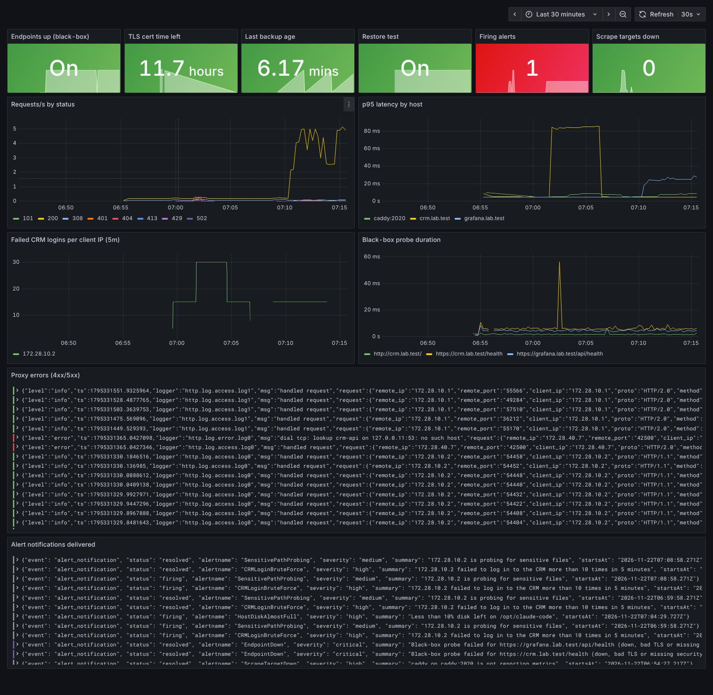
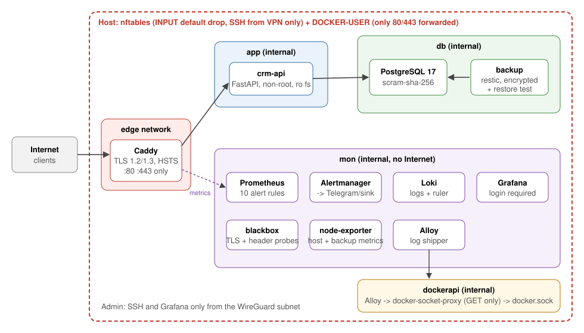

# infra-security-monitoring


> **A hardened single-host web stack you can bring up with one command, and a
> script that proves it is secure: 41 end-to-end checks covering TLS, network
> exposure, container hardening, log-based attack detection, alert delivery,
> and a timed disaster-recovery drill.**

It is the kind of setup I build for small businesses running one VPS: a public
API behind a TLS reverse proxy, a private database, centralised logs,
monitoring with alerts, and backups that are tested automatically. The
application is my own [crm-demo](https://github.com/darkside0001/crm-demo)
API, built from a pinned commit. Everything runs locally in Docker; nothing
here describes a real client's system.


*Grafana after a `verify.sh` run: black-box probes, certificate lifetime,
backup age and restore test, then the brute-force simulation showing up as
failed logins per client IP and as delivered alerts.*

## What this project demonstrates

| Skill | Evidence |
|-------|----------|
| Secure reverse proxy and TLS | [`caddy/Caddyfile`](caddy/Caddyfile): TLS 1.2/1.3 only, HSTS, headers, no banner, body limit, slowloris timeouts, XFF overwrite |
| Network segmentation | 5 Docker networks, 4 internal; only Caddy publishes ports ([ADR 0002](docs/adr/0002-network-segmentation.md)) |
| Host firewall that works with Docker | [`firewall/`](firewall/): nftables + DOCKER-USER, **tested for real** in a network namespace ([ADR 0004](docs/adr/0004-firewall.md)) |
| Monitoring and alerting | Prometheus, black-box TLS/header probes, 10 alert rules, Alertmanager with routing and inhibition |
| Centralised logging and detection | Alloy -> Loki via a read-only Docker socket proxy; log-based alerts for brute force (T1110) and sensitive-path probing (T1595.003) |
| Backup and recovery | restic (encrypted, deduplicated), automatic restore test with row-count comparison, DR drill with measured RTO ([ADR 0005](docs/adr/0005-backup-and-recovery.md)) |
| Access control and secrets | file-based secrets, Grafana login only + private-range allowlist, no route to Prometheus/Loki/DB from outside ([ADR 0006](docs/adr/0006-secrets-and-container-hardening.md)) |
| Container hardening | `cap_drop: ALL`, `no-new-privileges`, read-only root fs, non-root users, limits; exceptions documented and checked |
| Threat modelling | [STRIDE threat model](docs/threat-model.md), each control linked to the check that verifies it |
| Operations | [runbook](docs/runbook.md) for every alert, CI that validates all configs and runs the full verification |

## Architecture



| Component | Role | Exposed |
|-----------|------|---------|
| Caddy 2.10 | TLS termination, security headers, access logs (JSON), metrics | 80, 443 |
| crm-demo API | FastAPI application (JWT, RBAC, rate limiting) | app network only |
| PostgreSQL 17 | data, scram-sha-256 auth | db network only |
| backup | `pg_dump` -> restic, restore test, metrics | db network only |
| Prometheus 3.5 + Alertmanager | metrics, 10 alert rules, routing | internal |
| blackbox-exporter | probes the site like a user: TLS chain, HSTS, banner, redirect | internal |
| node-exporter | host metrics + backup metrics (textfile collector) | internal |
| Loki 3.5 + Alloy | log storage (30 days) and log-based alert rules; shipper | internal |
| docker-socket-proxy | read-only Docker API for the log shipper | internal |
| Grafana 12 | dashboards, login required | via Caddy, private ranges only |

Design decisions are recorded as ADRs in [`docs/adr/`](docs/adr/).

## Quick start

Requirements: Docker with Compose v2, `openssl`, `python3`. Ports 80 and 443 free.

```bash
git clone https://github.com/darkside0001/infra-security-monitoring
cd infra-security-monitoring
./scripts/gen-secrets.sh          # random passwords, lab CA (git-ignored)
docker compose up -d --build      # ~2 minutes the first time
./scripts/verify.sh               # 41 checks, writes reports/verification-report.md
./firewall/test-firewall.sh       # host firewall test in a throwaway namespace
```

Open the dashboard: add `127.0.0.1 crm.lab.test grafana.lab.test` to your
hosts file, trust `secrets/lab-ca.crt` in the browser (or accept the warning),
go to https://grafana.lab.test and log in as `admin` with the password from
`secrets/grafana_admin_password`.

## Verification

[`scripts/verify.sh`](scripts/verify.sh) checks the running stack from three
sides: the Docker host, an "outside" scanner container that sits on the edge
network like an Internet client, and the monitoring plane. Last run:
**41 passed, 0 failed** ([full report](reports/verification-report.md)).

| Area | Checks |
|------|--------|
| Exposure | only 80/443 published; full 65535-port nmap scan of the proxy shows only 80/443 ([nmap-report output](reports/nmap-edge.md)); PostgreSQL, Prometheus, Loki and the API container unreachable from the edge |
| TLS and HTTP | TLS 1.3 and 1.2 accepted, 1.1 and 1.0 rejected, unknown CA rejected, HTTP -> HTTPS 308, security headers, no banner, `/docs` hidden, 1 MB body limit, [web-sec-check](https://github.com/darkside0001/web-sec-check) grade A ([report](reports/web-sec-check.md); its one warning is expected: lab certificates from Caddy's internal CA live 12 hours and renew automatically) |
| Access control | API refuses requests without a token, Grafana API refuses anonymous access, brute force throttled (401 x10 then 429) |
| Containers | no privileged containers, `no-new-privileges` everywhere, Docker socket only in the read-only proxy, read-only root fs except PostgreSQL, capability exceptions listed |
| Detection | simulated brute force and `/.env`-style probing raise Loki alerts with the **real** client IP even though the scanner sent spoofed `X-Forwarded-For` headers; Alertmanager delivers the notification |
| Monitoring | all 10 scrape targets up, black-box probes green, certificate expiry tracked, proxy logs present in Loki |
| Backup and DR | encrypted backup, restic check, restore test with row-count comparison, then a **DR drill**: customers and orders truncated, latest snapshot restored, API healthy again (measured RTO 34 s) |

The firewall test ([`reports/firewall-test.txt`](reports/firewall-test.txt))
loads the real `nftables.conf` and checks 10 cases, including the SSH rate
limit adding a flooding client to a 15-minute blocklist.

The first run of `verify.sh` found a real problem: Caddy's metrics port 2020
was reachable from the edge network (protected only by an IP check). Fixed by
binding it to the monitoring network address
([ADR 0001](docs/adr/0001-caddy-reverse-proxy.md)).

## Detections

| Alert | Source | Fires when | ATT&CK |
|-------|--------|-----------|--------|
| CRMLoginBruteForce | Loki (Caddy JSON log) | > 10 failed/throttled logins from one IP in 5 min | T1110 |
| SensitivePathProbing | Loki | > 5 requests for `/.env`, `/.git`, `wp-admin`... in 5 min | T1595.003 |
| UnexpectedAuthFailures | Prometheus | sustained 401/403/429 rate at the proxy | — |
| EndpointDown | blackbox | site down, bad TLS chain, HSTS missing or banner present | — |
| TLSCertificateExpiringSoon | blackbox | certificate renewal failing | — |
| High5xxRate | Caddy metrics | > 5 % 5xx for 5 min | — |
| BackupMissing / BackupTooOld | backup metrics | no backup / older than 26 h | — |
| RestoreTestFailed | backup metrics | latest backup could not be restored | — |
| ScrapeTargetDown, HostDiskAlmostFull, HostMemoryPressure | Prometheus | the usual | — |

Every alert has a section in the [runbook](docs/runbook.md).

## Repository layout

```
docker-compose.yml        the whole stack, hardened defaults in one anchor
caddy/Caddyfile           public surface
prometheus/               scrape config and alert rules
alertmanager/             routing, inhibition, Telegram example
blackbox/                 probe modules (TLS, headers, redirect)
loki/                     storage, retention, log-based alert rules
alloy/                    log shipping via the socket proxy
grafana/                  provisioned datasources and dashboard
backup/                   backup, restore test, restore (restic + pg_dump)
firewall/                 nftables ruleset, DOCKER-USER rules, live test
scripts/                  gen-secrets.sh, verify.sh
tests/scanner/            outside-view checks (probe.py), web-sec-check, nmap-report
docs/                     architecture, ADRs, threat model, runbook
reports/                  output of the last verification run
```

## Moving it to a real server

1. Point DNS at the server, replace `crm.lab.test` / `grafana.lab.test`, delete
   the `import tls_lab` lines (Caddy then uses Let's Encrypt) and set
   `TLSCertificateExpiringSoon` to 14 days.
2. Install `firewall/nftables.conf` with your WireGuard subnet in
   `admin-net.nft`, and run `firewall/docker-user.sh` at boot.
3. Point `RESTIC_REPOSITORY` at off-site storage with append-only credentials.
4. Switch the Alertmanager receiver to Telegram (example in the config).
5. Narrow the Grafana allowlist from `private_ranges` to the VPN subnet.
6. Harden the host itself, for example with
   [linux-hardening-audit](https://github.com/darkside0001/linux-hardening-audit).

## Related projects

- [crm-demo](https://github.com/darkside0001/crm-demo): the application this stack serves
- [soc-home-lab](https://github.com/darkside0001/soc-home-lab): Wazuh SIEM lab with ATT&CK-mapped detection rules
- [web-sec-check](https://github.com/darkside0001/web-sec-check) and [nmap-report](https://github.com/darkside0001/nmap-report): used by `verify.sh`
- [linux-hardening-audit](https://github.com/darkside0001/linux-hardening-audit): host baseline audit

## License

MIT
